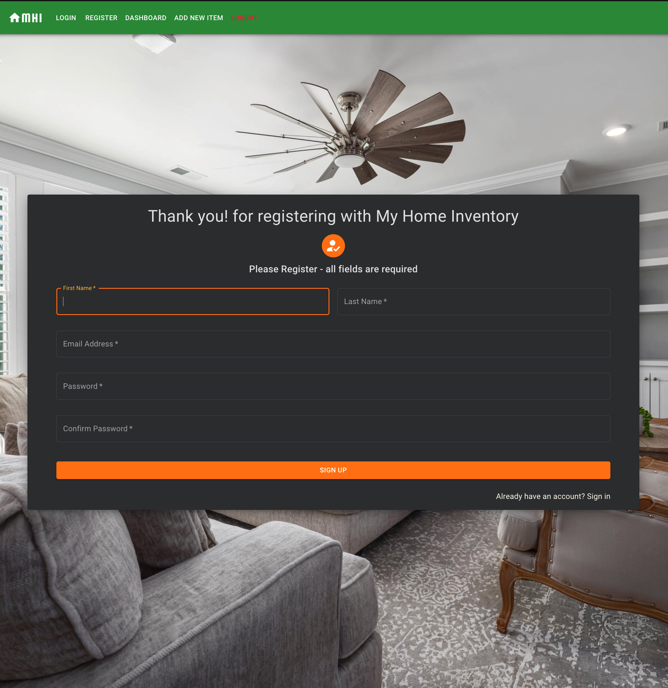
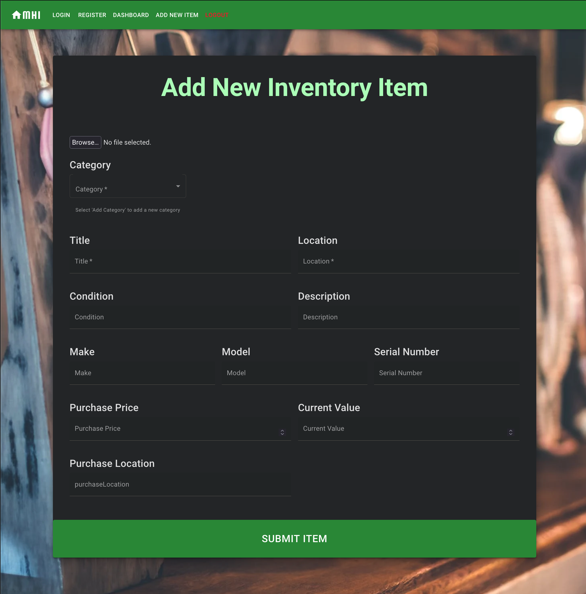

# MyHomeInventory 🏠

**A full-stack inventory management application built with the MERN stack.**

MyHomeInventory is a web application for organizing and managing personal belongings. Users can create accounts, maintain inventory records, attach images, and update or delete items.

I developed this project in 2022 as part of my full-stack software development training, working across frontend interfaces, backend API routes, data modeling, and database integration.

**Technologies:** MongoDB · Express.js · React · Node.js · JavaScript · Mongoose · Material UI

---

## ✨ Features

- User registration, login, and logout
- Create, view, update, and delete inventory records
- Associate inventory items with user accounts
- Upload images for inventory items
- Organize records using categories
- Responsive user interface built with React and Material UI

---

## 📸 Application Screenshots

More screenshots are available in the repository's `client/src/assets/images` directory.

---

## 🛠️ Technical Overview

### Frontend

- React for interface development
- Material UI and Bootstrap for interface styling
- React Router for client-side navigation
- Axios for HTTP requests

### Backend

- Node.js and Express.js
- REST-style endpoints for users, categories, and inventory records
- Registration and login functionality
- Image upload handling using Multer
- Mongoose for MongoDB data modeling and access

### Database

MongoDB stores application data, including user accounts and inventory records.

---

## 📁 Project Structure

- `client/` — React frontend
- `server/config/` — Database and authentication configuration
- `server/controllers/` — Application request handlers
- `server/models/` — Mongoose data models
- `server/routes/` — API route definitions
- `server.js` — Express application entry point

---

## 📌 Project Status

**Completed portfolio project — 2022**

The original hosted deployment is no longer online. This repository preserves the application source code and screenshots as an example of my full-stack development work.

The project uses dependencies from its original development period and may require configuration and dependency updates before being run locally.

---

## 👨‍💻 About the Developer

Developed by Craig Burke as a full-stack web development portfolio project.

This application demonstrates frontend development, backend API implementation, database modeling, and integration of multiple technologies into a working application.

[GitHub Profile](https://github.com/CragarDev) · [LinkedIn](https://www.linkedin.com/in/cragardev/) · [Developer Portfolio](https://craigburke-portfolio.netlify.app)
